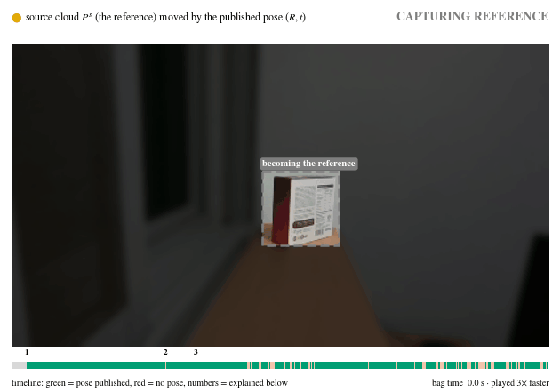
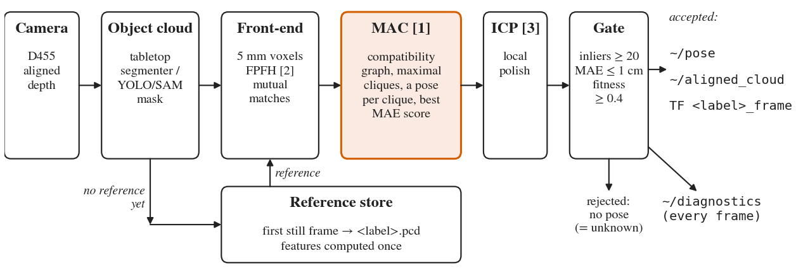
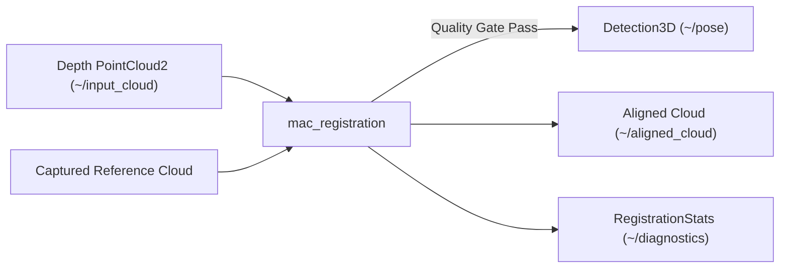
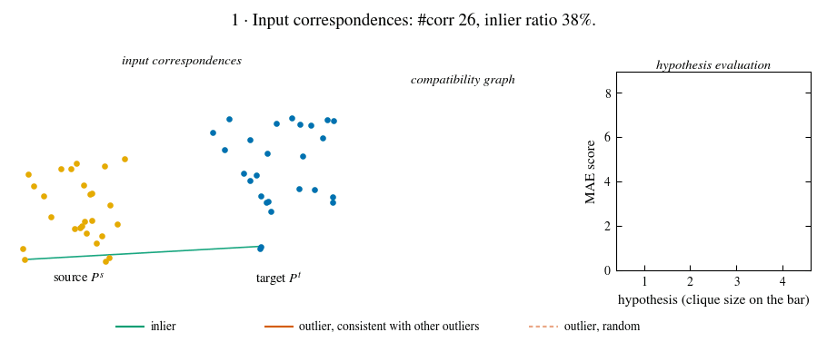

# mac_registration

[](https://docs.ros.org/en/humble/) [](LICENSE) [](mailto:teamrobontu@gmail.com)

Finds a known object in a depth-camera point cloud. Publishes the object pose in the camera
frame. Rejects unreliable poses.

<p align="center"></p>

A recorded D455 bag (480×270, played 3× faster) replayed through the node, while a hand
slides and turns a box. The GIF pauses on three moments:

1. The first still view becomes the reference: MAC's source cloud P<sup>s</sup>.
2. A frame fails the quality gate: nothing is published, rather than a doubtful pose. The next
   good frame publishes again.
3. Gold = P<sup>s</sup> moved by the published pose (R, t). It follows the box as it slides and
   turns.

Colours follow the paper: source gold, green = pose published, red = no pose.

<p align="center"></p>


## Architecture



## 1. Setup

**Requirements:** Ubuntu 22.04 · ROS 2 Humble · RealSense D455

```bash
cd ~/ros2_ws
git clone https://github.com/Team-Robo/public-core-mac_registration.git src/core-mac_registration
sudo src/core-mac_registration/scripts/install_igraph.sh     # once: igraph 0.10.17
MAKEFLAGS=-j4 colcon build --packages-select mac_registration --symlink-install \
  --cmake-args -DCMAKE_BUILD_TYPE=Release
source install/setup.bash
```

WSL only: run `usbipd attach --wsl --hardware-id 8086:0b5c` (the D455) in Windows PowerShell.
Repeat after every replug. If it fails with "Device in error state", run it again: the camera
resets on the first attach.

## 2. Run

```bash
ros2 launch mac_registration mac_registration.launch.py camera_type:=d455
```

## 3. Input

| Topic | Type | Content |
|---|---|---|
| `~/input_cloud` | `sensor_msgs/PointCloud2` | object points in the camera frame |

- The launch file connects the topic automatically.
- Optional `intensity` field: 1 = object, 0 = background.

## 4. Output

| Topic | Type | Published on | Content |
|---|---|---|---|
| `~/pose` | `vision_msgs/Detection3D` | accepted frames | object pose |
| `~/aligned_cloud` | `sensor_msgs/PointCloud2` | accepted frames | reference points moved onto the object |
| `~/diagnostics` | `mac_registration/RegistrationStats` | every frame | verdict, reject reason, scores, timings |
| TF `<label>_frame` | tf2 | accepted frames, with `publish_tf:=true` | TF copy of `~/pose` |

`~/pose` fields:

| Field | Meaning |
|---|---|
| `header` | copy of the input header: capture time, camera frame |
| `results[0].pose.pose.position` | object centre now (m) |
| `results[0].pose.pose.orientation` | object rotation since capture |
| `results[0].hypothesis.score` | fitness, 0–1; 1 = perfect overlap |
| `results[0].hypothesis.class_id` | label |

Rules:

- Missing pose = unknown. Missing pose ≠ object gone.
- `~/diagnostics` gives the reject reason.
- Look up the world transform with tf2 at `header.stamp`.

## 5. Use the pose

Reuse a grasp in three steps:

1. Plan a grasp once. Store the grasp in the object frame: `T_O_G = inverse(T_C_O) * T_C_G`.
2. Read each new `~/pose` as `T_C_O`.
3. Compute the new grasp in the world frame: `T_W_G = T_W_C * T_C_O * T_O_G`.

| Symbol | Meaning |
|---|---|
| `T_C_O` | object pose from `~/pose` |
| `T_C_G` | grasp pose in the camera frame (AnyGrasp) |
| `T_W_C` | camera pose in the world frame (tf2) |

Services:

| Service | Effect |
|---|---|
| `/mac_registration/capture_reference` | takes a new reference from the next frame |
| `/mac_registration/clear_reference` | deletes the saved reference |

The node saves references to `~/.ros/mac_registration/<label>.pcd`. The node reloads saved
references at start-up.

## 6. Potential applications

- **Localisation:** `mode:=scene` aligns the live scene to a saved scene reference. The result
  gives the camera pose relative to a known place.
- **Pose estimation and tracking:** gives the 6-DoF pose of a known object every frame. Use it
  for inspection, part checks or following moving items.
- **Spatial alignment:** registers a sensor cloud to a reference cloud. Use it for
  camera-to-fixture calibration or multi-camera alignment.
- **Mapping and navigation:** recognises known places or landmarks. Use it to correct drift or
  anchor a map.

## 7. How MAC works

<p align="center"></p>

The GIF runs the paper's pipeline on the toy problem of
[Figure 2](media/fig2_mac.png). Colours follow the
paper: source P<sup>s</sup> gold, target P<sup>t</sup> blue, inliers green, outliers red.

1. **Input correspondences:** descriptors pair source points with target points. Most are
   outliers.
2. **Graph construction:** correspondences whose distances agree get an edge. A rigid motion
   keeps distances.
3. **Search maximal cliques:** each clique gives a hypothesis (R, t) by SVD, scored by MAE.
4. **3D registration:** the best score wins, not the maximum clique. As in the paper's Fig. 1,
   the maximum clique (6 correspondences, inlier ratio 0%) fails; MAC's pick (5, inlier ratio
   100%) succeeds.

## 8. Citation

- **Original Repository:** [zhangxy0517/3D-Registration-with-Maximal-Cliques](https://github.com/zhangxy0517/3D-Registration-with-Maximal-Cliques)

X. Zhang, J. Yang, S. Zhang, Y. Zhang. *3D Registration with Maximal Cliques.* CVPR 2023,
pp. 17745–17754.

## Contributors

- **Dun Yan Ong** (`@dunyanong`)

Maintained by **Nanyang Technological University Team Robo** (`teamrobontu@gmail.com`).

## License

This project is licensed under the Apache License 2.0 — see the [LICENSE](LICENSE) and [NOTICE](NOTICE) files for details. (Upstream `third_party/MAC` is licensed under the MIT License.)
